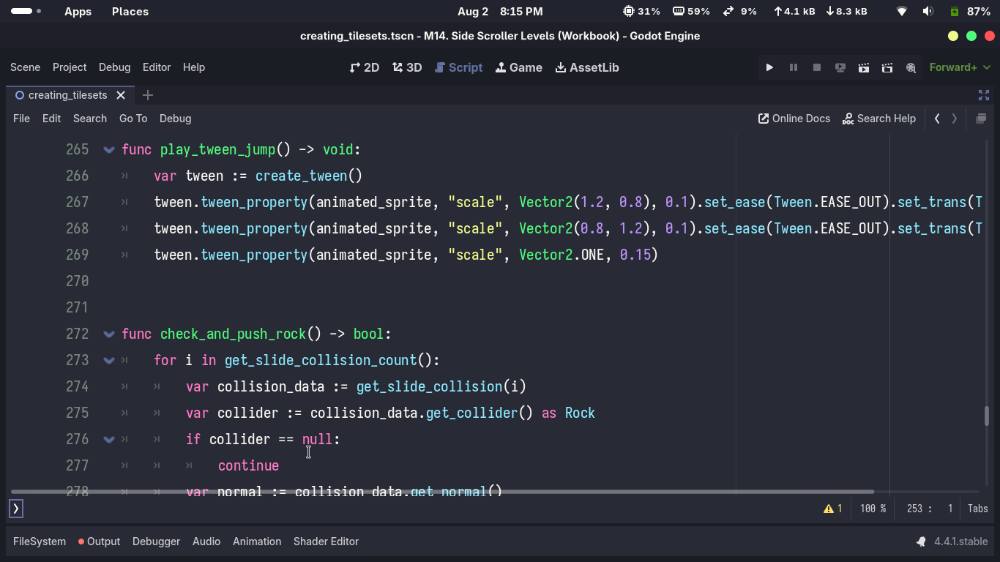

# Dracula for [Godot](https://godotengine.org)

> A dark theme for [Godot Engine](https://godotengine.org).

## Install

All instructions can be found at [draculatheme.com/godot](https://draculatheme.com/godot).

## Team

This theme is maintained by the following person(s) and a bunch of [awesome contributors](https://github.com/dracula/godot/graphs/contributors).

|  |  |
| ----------------------------------------------------------------------------------------- | ------------------------------------------------------------------------------------------------------ |
| [Gustavo Damiani](https://github.com/damiiani)                                            | [Abdul Hannan Ahmed](https://github.com/hannan-ahmad)                                                  |

## Community

- [Twitter](https://twitter.com/draculatheme) - Best for getting updates about themes and new stuff.
- [GitHub](https://github.com/dracula/dracula-theme/discussions) - Best for asking questions and discussing issues.
- [Discord](https://draculatheme.com/discord-invite) - Best for hanging out with the community.

## Dracula PRO

## License

[MIT License](./LICENSE)
